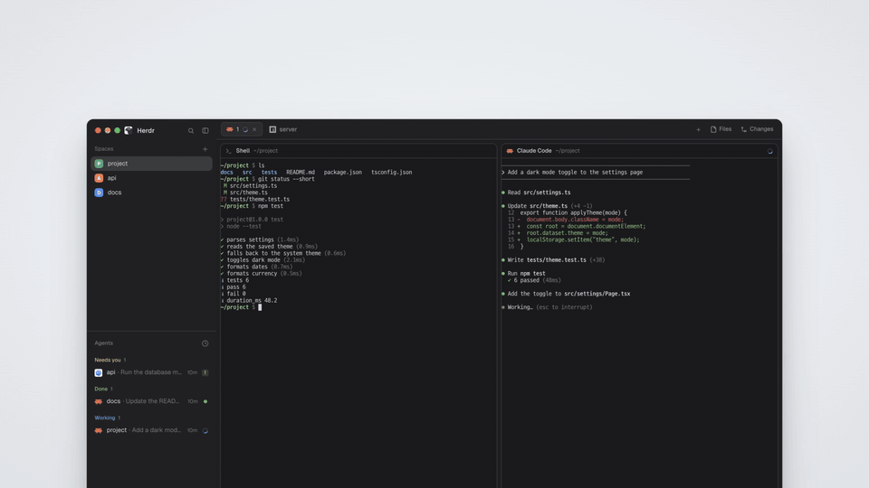

# herdr-relay

[English](README.md)

[](docs/media/intro.mp4)

*18초, 소리 없음. Herdr 옆에서 브리지를 띄우면 같은 레이아웃이 iPad와 휴대폰에 열리고 iPad에서 사이드바 폭을 바꿔도 Mac의 레이아웃은 그대로입니다. 합성 데이터로 띄운 실제 렌더입니다. 누르면 MP4가 열립니다.*

herdr-relay는 Mac에서 쓰는 [Herdr](https://herdr.dev) 화면을 휴대폰과 태블릿으로 옮겨 줍니다. Herdr와 같은 Mac에서 돌면서
같은 레이아웃과 모드를 그리고, 그 결과를 Tailscale 네트워크 너머의 웹 앱으로 보냅니다. 웹 앱은 홈 화면에 추가해 두고 쓰면
됩니다. 스페이스, 탭, 에이전트, 터미널이 작은 화면에 맞게 다시 배치되고, 기기에서 보기를 바꾸거나 모드 명령을 실행하거나
터미널에 입력할 수도 있습니다. 에이전트가 일을 끝내거나 입력을 기다리면 푸시 알림이 옵니다.

모드는 손대지 않고 원래 코드 그대로 실행하며, 그 코드는 Mac 밖으로 나가지 않습니다. 모드 폴더마다 샌드박스 안에서 별도
프로세스가 뜨고, 기기가 받는 것은 모드가 그린 요소 트리뿐입니다. 모드가 파일을 읽거나 프로세스를 실행하거나 네트워크에
연결하려 하면 브리지가 먼저 허용 여부를 판단합니다.

## 현재 상태와 제한

지금 버전은 처음 공개하는 **0.1.0**입니다.

- **macOS 전용입니다.** 모드 샌드박스로 macOS Seatbelt를 씁니다. Linux(bubblewrap)는 계획 중이고, Windows는 지원하지 않습니다
  ([docs/PLATFORMS.md](docs/PLATFORMS.md)).
- **Tailscale로만 접속합니다.** 기기는 tailnet 안에서 `tailscale serve`를 거쳐 Mac에 붙습니다. 인터넷에 공개하는 Funnel은
  거부하고, 리버스 프록시 방식은 아직 없습니다.
- **Herdr 0.1.14와 0.1.15에서 테스트했습니다.** 다른 버전에서도 돌아가지만 경고 배너가 뜹니다([호환성](#호환성)).
- 기기에서 보는 터미널은 Mac 터미널의 크기를 따릅니다. 보기만 할 때는 Mac 터미널 크기를 건드리지 않습니다. 다만 입력할 때는
  herdr-core의 attach 방식에 한계가 있어 Mac 터미널 크기가 잠깐 바뀔 수 있습니다([docs/AMENDMENTS-c1-wave3.md](docs/AMENDMENTS-c1-wave3.md)).
- 워크트리 생성, 머신 추가처럼 구조를 바꾸는 작업은 Mac에서만 할 수 있습니다. 기기에서 시도하면 안내 메시지가 뜹니다.

## 요구 사항

| | 버전 |
|---|---|
| macOS | 샌드박스 프로필은 macOS 27 기준으로 만들었습니다. 다른 버전이면 확인 절차를 먼저 실행하세요([docs/INSTALL.md](docs/INSTALL.md) §8) |
| [Deno](https://deno.com) | 2.9 이상 |
| [Herdr](https://herdr.dev) 앱 | 0.1.13~0.1.15. `herdr-app`과 `hc`가 `PATH`에 있어야 합니다 |
| [Tailscale](https://tailscale.com) | macOS 앱에 로그인한 상태, MagicDNS와 HTTPS 인증서 사용 |
| 기기 | 같은 tailnet에 있는 iPhone·iPad(Safari) 또는 Android(Chrome) |

## 설치

자세한 안내는 [docs/INSTALL.md](docs/INSTALL.md)를 보세요. 릴리스 tarball, launchd로 로그인할 때 자동 실행하기, 업그레이드,
삭제까지 다룹니다. 저장소를 클론해서 설치하려면:

```sh
git clone https://github.com/Lapis0875/herdr-relay.git
cd herdr-relay
deno install --frozen
deno task bundle                       # 기기용 웹 앱
deno task --cwd packages/web fonts     # 웹 앱에 넣을 글꼴
ln -s "$PWD/packages/bridge/bin/herdr-relay" ~/.local/bin/herdr-relay
herdr-relay doctor                     # Deno, 샌드박스, Tailscale, Herdr 점검
```

브리지를 띄운 다음(`herdr-relay start` 또는 launchd 에이전트):

```sh
herdr-relay serve                              # tailnet에 공개
herdr-relay pair --scope act --name "iPad"     # 기기 하나에 쓸 일회용 코드
herdr-relay install-mod                        # 미러 모드: 기기의 테마·글꼴·포커스를 Mac과 맞춤
```

기기에서 `https://<mac>.<tailnet>.ts.net/herdr-relay/`를 열어 코드를 입력하고 홈 화면에 추가합니다. Homebrew formula는
`packaging/homebrew/`에 준비해 두었지만 아직 공개하지 않았습니다.

## 내 모드에 프로필 쓰기

Herdr에 기본으로 들어 있는 모드 21개는 프로필이 이미 있어서 따로 설정할 필요가 없습니다. 프로필에 이름이 없는 모드
폴더는 자기 파일과 스페이스 폴더만 읽을 수 있고, `exec`·`hc`·네트워크 호출은 거부됩니다. 화면은 평소대로 그려집니다.
직접 만든 모드가 필요한 작업을 하게 하려면 정책 프로필을 쓰면 됩니다. 폴더 이름과 허용할 요청 종류를 적는 작은 JSON
파일입니다. 필드 설명, 한계, 테스트 방법은 [docs/PROFILES.md](docs/PROFILES.md)에 정리해 두었습니다.

## 보안

- 이 Mac을 소유한 Tailscale 계정만 접속할 수 있고, 그중에서도 일회용 코드로 페어링한 기기만 들어올 수 있습니다. 기기마다
  `read`(보기만) 또는 `act`(입력과 명령까지) 권한을 정해 페어링하며, 언제든 해제할 수 있습니다.
- 기기는 모드 코드를 받지 않습니다. 모드 폴더마다 권한 없는 Deno 프로세스가 macOS Seatbelt 프로필 안에서 따로 돌고,
  `exec`·`hc`·파일 읽기·네트워크 연결은 브리지가 인자 단위 규칙으로 하나씩 판단합니다.
- Herdr는 모드를 신뢰하는 코드로 취급하고, herdr-relay도 같은 전제를 따릅니다. 기기에서 모드에 시킬 수 있는 일은
  제한하지만, 악의적인 모드를 설치해도 안전하게 만들어 주지는 못합니다.

위협 모델과 취약점 제보 방법은 [SECURITY.md](SECURITY.md), 전체 보안 모델과 테스트 표는 [docs/SECURITY.md](docs/SECURITY.md)에서
볼 수 있습니다.

## 호환성

| Herdr 앱 | 상태 |
|---|---|
| 0.1.15 | 테스트 완료 |
| 0.1.14 | 테스트 완료 |
| 0.1.13 | 지원하지만 테스트하지 않음. 기기에 배너 표시 |
| 0.1.13보다 오래된 버전 | 지원하지 않음. 브리지는 돌아가며 배너 표시 |
| 0.1.15보다 새 버전 | 아직 테스트하지 않음. 배너와 함께 동작 |

Herdr가 바뀌면 브리지는 실행 중인 버전을 고정해 둔 계약(contract pin)과 비교하고, 달라진 부분을 기기 화면과
`herdr-relay doctor`로 알립니다. 이때도 모드에 허용하는 범위는 넓히지 않습니다. 자세한 내용은
[docs/COMPATIBILITY.md](docs/COMPATIBILITY.md)를 참고하세요.

## 문서

| 문서 | 내용 |
|---|---|
| [docs/INSTALL.md](docs/INSTALL.md) | 설치, 실행, 업그레이드, 삭제 |
| [docs/DEVICES.md](docs/DEVICES.md) | 기기 종류, 페어링, 운영 |
| [docs/PROFILES.md](docs/PROFILES.md) | 직접 만든 모드를 위한 정책 프로필 |
| [docs/SECURITY.md](docs/SECURITY.md) | 프로세스 구조, 샌드박스, 보안 테스트 표 |
| [docs/POLICY.md](docs/POLICY.md), [docs/PROTOCOL.md](docs/PROTOCOL.md) | 실행·파일 정책, 통신 프로토콜 |
| [docs/COMPATIBILITY.md](docs/COMPATIBILITY.md), [docs/PLATFORMS.md](docs/PLATFORMS.md) | Herdr 버전, 운영체제 |
| [RECIPE.md](RECIPE.md) | 미러 모드 |

문서는 모두 영어입니다.

## 기여

[CONTRIBUTING.md](CONTRIBUTING.md)를 읽어 주세요. 변경 내역은 [CHANGELOG.md](CHANGELOG.md)에 정리합니다.

## 라이선스

Copyright 2026 Lapis0875. [Apache License 2.0](LICENSE)으로 배포합니다. 서드파티 구성 요소와 각 라이선스는
[THIRD_PARTY_NOTICES](THIRD_PARTY_NOTICES)에 모아 두었습니다.
