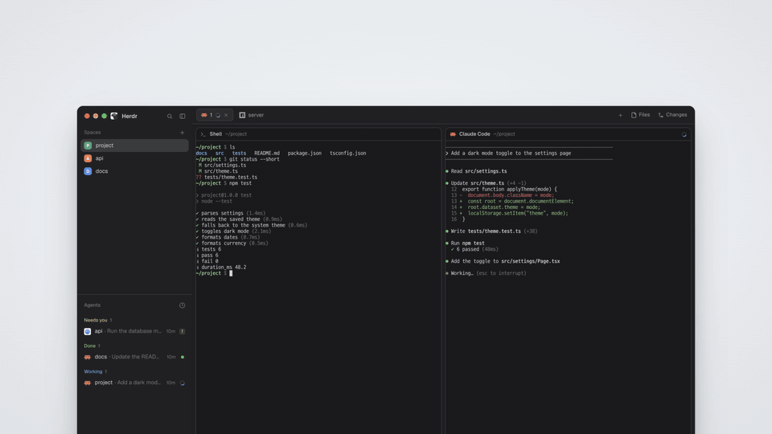

# herdr-relay

[한국어](README.ko.md)

[](docs/media/intro.mp4)

*18 seconds, no sound: the bridge starts beside Herdr, the same layout opens on an iPad and a phone, and resizing the iPad's sidebar leaves the Mac's layout as it was. Real renders of synthetic content; click for the MP4.*

herdr-relay puts your [Herdr](https://herdr.dev) window on your phone and tablet. It runs on the Mac next to Herdr,
renders the same layouts and mods there, and serves them over your Tailscale network to a web app you add to the home
screen. You see your spaces, tabs, agents and terminals, rearranged for a small screen, and you can act on them: switch
views, run a mod's commands, type into a terminal, and get a push notification when an agent finishes or needs you.

The mods themselves are not changed and never leave the Mac. Each mod folder runs in its own sandboxed process; devices
receive only the element trees the mods draw, and every file, process or network request a mod makes is checked by the
bridge first.

## Status and limitations

herdr-relay is at **0.1.0**, the first public version.

- **macOS only.** The mod sandbox is macOS Seatbelt. Linux (bubblewrap) is planned; Windows is not supported
  ([docs/PLATFORMS.md](docs/PLATFORMS.md)).
- **Tailscale only.** Devices reach the Mac through `tailscale serve` on your tailnet. Funnel (public internet) is
  refused, and there is no reverse-proxy mode yet.
- **Tested with Herdr 0.1.14 and 0.1.15.** Other versions run with a warning banner ([Compatibility](#compatibility)).
- Devices see the Mac's terminals at the Mac's size. Viewing a terminal never resizes it on the Mac; typing into it
  may briefly resize it, because of a herdr-core attach limitation
  ([docs/AMENDMENTS-c1-wave3.md](docs/AMENDMENTS-c1-wave3.md)).
- Structural changes (creating worktrees, adding machines and similar) stay on the Mac; devices are told so.

## Requirements

| | Version |
|---|---|
| macOS | the sandbox profile was derived on macOS 27; on another version, run its check ([docs/INSTALL.md](docs/INSTALL.md) §8) |
| [Deno](https://deno.com) | 2.9 or newer |
| [Herdr](https://herdr.dev) app | 0.1.13 to 0.1.15, with `herdr-app` and `hc` on `PATH` |
| [Tailscale](https://tailscale.com) | the macOS app, logged in, with MagicDNS and HTTPS certificates on |
| Devices | iPhone or iPad with Safari, or Android with Chrome, on the same tailnet |

## Install

The full guide is [docs/INSTALL.md](docs/INSTALL.md): release tarballs, starting at login with launchd, upgrades and
uninstalling. From a clone:

```sh
git clone https://github.com/Lapis0875/herdr-relay.git
cd herdr-relay
deno install --frozen
deno task bundle                       # the device app
deno task --cwd packages/web fonts     # the bundled fonts
ln -s "$PWD/packages/bridge/bin/herdr-relay" ~/.local/bin/herdr-relay
herdr-relay doctor                     # checks Deno, the sandbox, Tailscale and Herdr
```

Then, with the bridge running (`herdr-relay start`, or the launchd agent):

```sh
herdr-relay serve                              # publish it on your tailnet
herdr-relay pair --scope act --name "iPad"     # a one-time code for one device
herdr-relay install-mod                        # the mirror mod: exact theme, fonts and focus on devices
```

Open `https://<mac>.<tailnet>.ts.net/herdr-relay/` on the device, enter the code, and add the page to the home screen.
A Homebrew formula is prepared in `packaging/homebrew/` but not published yet.

## Your own mods: profiles

Herdr's 21 shipped mods come with built-in profiles. A mod folder that no profile names may read its own files and
the space folders, and nothing else: its `exec`, `hc` and network calls are refused, and it still renders. To let your
own mod run what it needs, write a policy profile, a small JSON file naming the folder and the request types it may
use. [docs/PROFILES.md](docs/PROFILES.md) explains the fields, the limits and how to test a profile.

## Security

- Only the Tailscale account that owns the Mac is let in, and only from devices paired with a one-time code. Each
  device is paired as `read` (view only) or `act` (also typing and commands), and can be revoked at any time.
- Devices never receive mod code. Each mod folder runs as its own unprivileged Deno process under a macOS Seatbelt
  profile, and the bridge decides every `exec`, `hc`, file read and network connection with argument-level rules.
- Herdr treats mods as trusted code, and so does herdr-relay: it limits what a device can make a mod do, but it does
  not make a hostile mod safe to install.

The threat model and how to report a vulnerability: [SECURITY.md](SECURITY.md). The full model and its test matrix:
[docs/SECURITY.md](docs/SECURITY.md).

## Compatibility

| Herdr app | Status |
|---|---|
| 0.1.15 | tested |
| 0.1.14 | tested |
| 0.1.13 | supported, not tested; devices show a banner |
| older than 0.1.13 | unsupported; the bridge still runs and shows a banner |
| newer than 0.1.15 | not tested yet; runs with a banner |

When Herdr changes, the bridge compares the running version with its pinned contract and reports drift to devices and
`herdr-relay doctor`; it never widens what mods may do. Details: [docs/COMPATIBILITY.md](docs/COMPATIBILITY.md).

## Documentation

| Document | Contents |
|---|---|
| [docs/INSTALL.md](docs/INSTALL.md) | install, run, upgrade, uninstall |
| [docs/DEVICES.md](docs/DEVICES.md) | device classes, pairing, operations |
| [docs/PROFILES.md](docs/PROFILES.md) | policy profiles for your own mods |
| [docs/SECURITY.md](docs/SECURITY.md) | process model, sandbox, security test matrix |
| [docs/POLICY.md](docs/POLICY.md), [docs/PROTOCOL.md](docs/PROTOCOL.md) | exec and file policy; wire protocols |
| [docs/COMPATIBILITY.md](docs/COMPATIBILITY.md), [docs/PLATFORMS.md](docs/PLATFORMS.md) | Herdr versions; operating systems |
| [RECIPE.md](RECIPE.md) | the mirror mod |

## Contributing

See [CONTRIBUTING.md](CONTRIBUTING.md). Changes are listed in [CHANGELOG.md](CHANGELOG.md).

## License

Copyright 2026 Lapis0875. Licensed under the [Apache License 2.0](LICENSE). Third-party components and their licenses:
[THIRD_PARTY_NOTICES](THIRD_PARTY_NOTICES).
