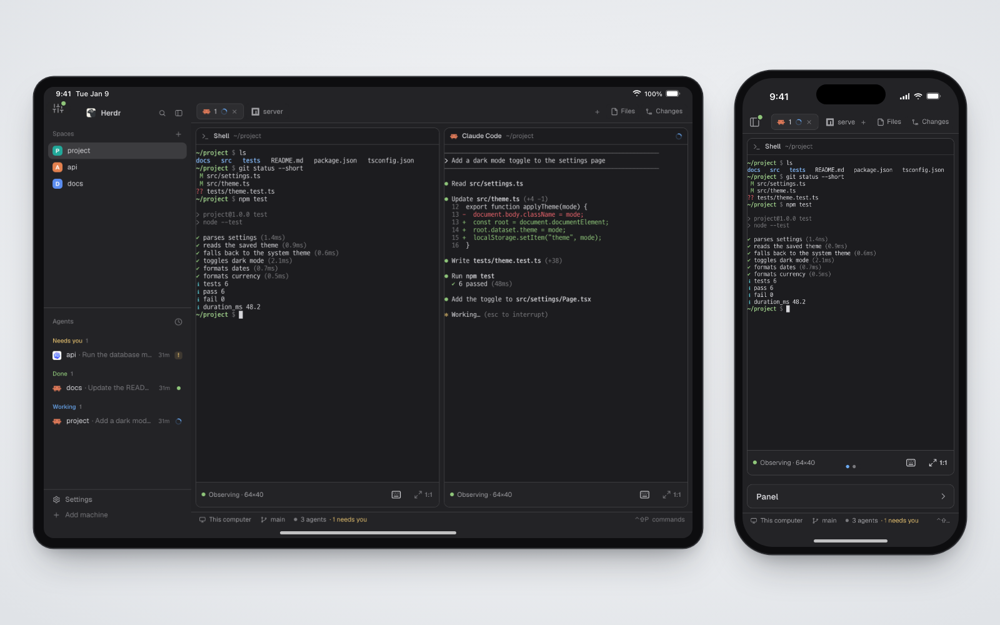

# herdr-relay mirror

An invisible helper for [herdr-relay](https://github.com/Lapis0875/herdr-relay), which shows this Herdr window on
phones and tablets. Nothing changes in the window itself. On the devices, the window looks and behaves like this one
from then on: the same theme colors (also Herdr's built-in `graphite`, `ink`, `moss` and `paper`, which exist only
inside the app), the same fonts and settings, and the pane and tab that are focused here.



<!-- preview.png (1600×1000): herdr-relay on an iPad (landscape) and an iPhone, relaying Herdr's shipped `main` layout
     in its default theme with the same focused tab and pane on both; the mod itself draws nothing. Captured in headless
     Chromium from a dev-mode bridge with a scratch home and a fake herdr-core; spaces, terminals and agents are made
     up. -->

## What you see

Nothing. The mod is a floating block that draws no content, so Herdr hides it: no frame, no space taken, no clicks
caught. Its effect is on the devices that herdr-relay serves.

## How it behaves

- Agent statuses (working, blocked, done, idle): not drawn. They reach the devices through `panes()`, as they are.
- Clicks, keys, hovers: none.
- Every time Herdr redraws the window (a theme switch, a focus change, an agent's title, a `shared` value), it sends
  one snapshot to the herdr-relay bridge on this Mac, 250 ms after a burst settles and only when something changed.
- Every 10 s it sends an unchanged snapshot again if the last one is older than 5 s, so the bridge knows the window
  is still there. After 30 s without one (the window is closed, a layout without the mirror is shown, or the mod is
  gone), the bridge marks the mirror stale: the devices keep the last theme, settings, fonts, commands, keys and
  versions, and take focus, panes and `shared` from herdr-core and `shared.json` again.
- When the bridge is not running, it sends nothing.

## Built from

- `mods/herdr-relay-mirror/`: `mod.json` (`{"place": "none", "title": "herdr-relay mirror", "version": "0.1.0"}`) and
  `main.js`, one `View` whose `render` returns an empty `div()` and arms a 250 ms `cx.timer.after`; no `props`, no
  art, no programs run, no `keys.json`.
- Placement: one floating entry on the root node of each layout you show (add to `floating` if the root has one):

  ```json
  "floating": [ { "id": "herdr-relay-mirror", "content": { "mod": "herdr-relay-mirror" }, "edge": "bottom", "align": "end" } ]
  ```

- `herdr` functions read: `theme`, `settings`, `fonts`, `layout`, `focused`, `panes`, `updates`, `window`,
  `commands`, `keys`, `shared(key)`, `home`, `appHome`, `readTextFile`. No commands are run.
- Network: `fetch` POST to `http://127.0.0.1:<port>/herdr-relay/mirror`, headers `Authorization: Bearer <token>` and
  `Content-Type: application/json`, body `{relayMod, theme, settings, fonts, layout, focused, panes, updates, window,
  commands, keys, shared}`: each value exactly as the `herdr` function returns it (a value that throws or is null is
  left out; `focused` may be null), `shared` holding every key, `relayMod` the version above.
- Files read (outside its folder): `~/.herdr/herdr-relay/mirror-endpoint.json` (`{"v":1,"port":7781,"pid":…}`,
  written by the bridge while it runs) for the port, `~/.herdr/herdr-relay/token` (the bridge's loopback token) for
  the header, and `<appHome>/shared.json` for the list of shared keys.
- The bridge answers `200 {"ok":true,"changed":…,"staleAfterMs":…,"bundledMod":…,"outdated":…}`, `401` for a wrong
  token, `400` with JSON Pointers when a value does not match Herdr 0.1.14's `herdr.d.ts` shapes. `GET` on the same URL
  with the token returns `{"state":"none"|"fresh"|"stale","receivedAt","relayMod","bundledMod","outdated","staleAfterMs"}`:
  `bundledMod` is the version of the copy herdr-relay ships, `outdated` whether `relayMod` is older than it. The bridge
  caches the last snapshot in `<appHome>/data/herdr-relay/mirror.json`.

## Watch out

- Tell the person before adding it: it reaches the network (only this Mac's `127.0.0.1`), runs no programs, and
  reads three files outside its folder (above), one of them the bridge's token.
- Placement is the part a fresh build gets wrong:
  - A `hidden` block never runs: a copy starts the first time it shows.
  - `place` other than `none` docks a visible panel.
  - A pane mod belongs to one tab.
  - An overlay window needs `mod.open` each time its layout shows.
  - A floating block that renders nothing is Herdr's own way to hide one ("render nothing to hide it"; the shipped
    `win98` Clippy does the same). It starts with the layout, keeps running while columns, stacks and tabs are hidden,
    and takes no space.
- Herdr starts mods per layout, so the mirror runs only in layouts that place it; add the entry to each one you show.
  Herdr's shipped layouts (`main`, `terminals`, `win98`) are read-only: `layout.clone` one and add it to the clone.
- `render` must not call `cx.notify()` (that throws); scheduling `cx.timer.after` there is fine.
- `shared()` has no "all keys" form in 0.1.14 (`shared("*")` is null), hence the key list from `shared.json`; a key
  set moments ago appears once Herdr has saved the file.
- `fetch` has no timeout: a POST not answered within 5 s is abandoned (raced against `cx.sleep`), so a stuck bridge
  never stops later snapshots.
- `window()`, `layout()` and `focused()` are null until a window shows (as in `herdr-app check`); those are left out.
- The bridge rejects the whole snapshot when one value has a shape `herdr.d.ts` 0.1.14 does not describe. A Herdr
  upgrade that changes a shape needs a herdr-relay update; the bridge log names the field.
- Keep `RELAY_MOD` in `main.js` equal to `mod.json`'s `version`: the bridge compares it with the version it ships. An
  older one is logged on the Mac and toasted to the connected devices once per version; `herdr-relay install-mod`
  installs the shipped copy.

## Done when

- `herdr-app check mods/herdr-relay-mirror` passes.
- With the bridge running and the entry in the shown layout, within a second:
  `curl -s -H "Authorization: Bearer $(cat ~/.herdr/herdr-relay/token)" http://127.0.0.1:7781/herdr-relay/mirror`
  prints `"state":"fresh"` and `"relayMod":"0.1.0"`.
- Switching the theme in Herdr changes a paired device's colors within a second.
- Quitting the Herdr window turns the same `curl` to `"state":"stale"` within 30 s, and the device keeps the theme.
